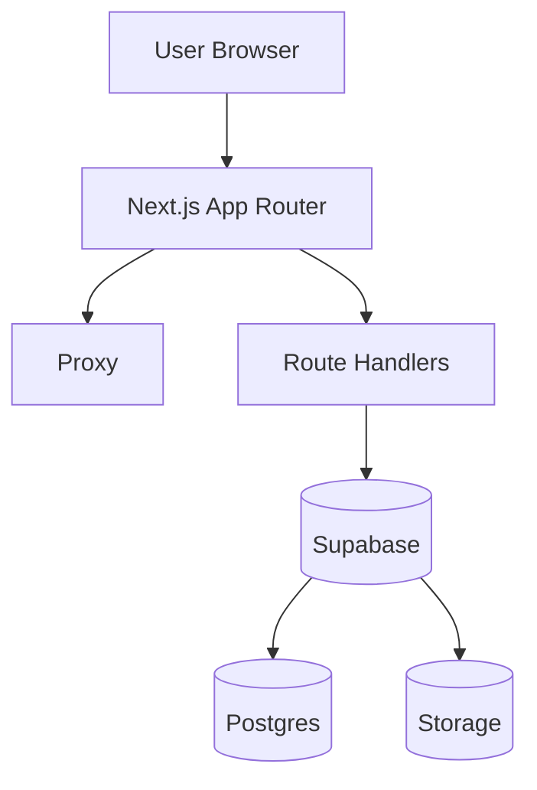

# Full-Stack Portfolio 2

A production-style **full‑stack portfolio application** built to demonstrate senior‑level engineering practices using **Next.js App Router** and **Supabase**.

This project focuses on **end‑to‑end ownership**: authentication, authorization, data validation, secure server APIs, and maintainable architecture.

https://fullstackportfolio.pages.dev/

---

## Tech Stack

- **Framework:** Next.js (App Router), TypeScript
- **Backend:** Supabase (Auth, Postgres, Storage)
- **Validation:** Zod
- **Styling:** Tailwind CSS
- **Testing:** Vitest
- **Deployment-ready:** SSR auth, RLS-secured database, server-only mutations

---

## Features

- Public portfolio pages (projects listing)
- Admin dashboard with full CRUD for projects
- OAuth authentication via Supabase
- Role-based access control (admin-only actions)
- Image uploads using Supabase Storage
- Server-side input validation
- Row Level Security (RLS) enforced at the database layer
- Light / dark / system theme (semantic CSS tokens, no flash on load)
- Optional TOTP two-factor authentication for the admin (`/admin/security`)
- SEO basics: canonical URL, Open Graph image, JSON-LD (Person + WebSite), sitemap and robots

---

## Architecture Overview



### Key Ideas

- **Server-first design**: data fetching and mutations happen on the server
- **Proxy (`src/proxy.ts`, formerly middleware) for UX**, RLS for real security
- **Strict API boundaries** using validation + whitelisting
- **Clear separation** between UI, API, and data access

See detailed breakdown:

- `docs/ARCHITECTURE.md`

---

## Authentication & Security

- OAuth authentication via Supabase
- Server-side session handling (SSR-compatible)
- Admin authorization via `profiles.is_admin`
- All sensitive operations executed server-side
- Postgres Row Level Security (RLS) enforces permissions at the database layer
- Optional TOTP MFA: enable it in Supabase (Authentication -> Multi-Factor), enroll an authenticator at
  `/admin/security`, then set `REQUIRE_ADMIN_MFA=true` to require it for `/admin/*` and `/api/admin/*`

Detailed explanation:

- `docs/SECURITY_AUTH_RLS.md`

---

## API Validation

- All write endpoints use **Zod schemas**
- Inputs are validated and whitelisted before DB writes
- Consistent error response format
- Prevents schema drift and unsafe writes

Schemas:

- `src/lib/validation/projects.ts`

API docs:

- `docs/API.md`

---

## Project Structure (simplified)

```
src/
  app/
    api/
    admin/
  lib/
    validation/
    http/
docs/
supabase/
tests/
```

---

## Running Locally

1. Install dependencies

```bash
npm install
```

2. Create `.env.local`

```env
NEXT_PUBLIC_SUPABASE_URL=
NEXT_PUBLIC_SUPABASE_ANON_KEY=
SUPABASE_SERVICE_ROLE_KEY=
```

Optional: `REQUIRE_ADMIN_MFA=true` (enroll an authenticator first; see `.env.example` for the other variables).

3. Run the app

```bash
npm run dev
```

---

## Deploy (Cloudflare Pages)

The site is the `fullstackportfolio` Cloudflare Pages project (https://fullstackportfolio.pages.dev), built with
[OpenNext](https://opennext.js.org/cloudflare). It is a **direct-upload** project: pushing to GitHub does not deploy
it. To deploy, run from this machine (logged in with `npx wrangler login`):

```bash
npm run deploy:pages
# = bash scripts/build-pages.sh && wrangler pages deploy .pages --project-name fullstackportfolio --branch main
```

`scripts/build-pages.sh` sets `NEXT_PUBLIC_SITE_URL` to the production URL (the build fails without it) and writes the
worker and static files to `.pages`. `npm run preview` runs the Cloudflare build locally.

The old `full-stack-portfolio-2` project (https://full-stack-portfolio-2.pages.dev) still builds from git, but with
`REDIRECT_TO` set it only 301s every path to the new URL.

Variables and secrets (`NEXT_PUBLIC_*`, `RESEND_API_KEY`, `TURNSTILE_SECRET_KEY`, `CONTACT_TO_EMAIL`) and the
compatibility settings (`nodejs_compat`) are in the Pages dashboard. `NEXT_PUBLIC_*` values are baked in at build
time. The pages that read the database (`/`, `/projects`) render on every request (`force-dynamic`).

## Seeding projects

`supabase/seed/*.sql` add the portfolio's projects to `public.projects` (one file per project, plus `games.sql` for
the browser games). Nothing applies them automatically: open the Supabase SQL editor for the shared project, paste a
file and run it. Each insert is skipped when a row with the same title (or the same live URL) already exists, so
re-running a file, or running one for a project added through `/admin/projects`, inserts nothing. They don't update
existing rows; edit those in the admin. New rows are published with `sort_order` 0 and stay off the home page until
"Show on home" is switched on in the admin (at most 3).

| File | Projects |
| --- | --- |
| `car-market-project.sql` | Car Market |
| `homefinder.sql` | HomeFinder |
| `diffbridge.sql` | Diffbridge |
| `the-long-chart.sql` | The Long Chart |
| `change-set-helper.sql` | Change Set Helper (no live URL until it's on the Chrome Web Store) |
| `games.sql` | Sunburn County, Trial Racer, Dustfront, Corsairs of the Archipelago |

## Testing

```bash
npm test           # Vitest (tests/)
npm run typecheck  # tsc --noEmit
npm run lint
```

Tests focus on:

- Input validation correctness
- API boundary behavior
- Error handling stability

See:

- `docs/TESTING.md`

---

## Design Decisions & Tradeoffs

Key decisions explained:

- Why Next.js App Router
- Why Supabase + RLS
- Why server-side auth
- Validation strategy

See:

- `docs/DECISIONS.md`

---

## What I Would Do at Scale

This project is intentionally scoped, but designed to grow.

Planned scale improvements:

- Caching & revalidation for public pages
- Rate limiting & audit logs for admin APIs
- Private storage + signed URLs
- Observability (logging, metrics, error reporting)
- CI/CD with migrations and preview environments

Details:

- `docs/SCALE.md`

---

## Summary

This repository demonstrates:

- Real-world full-stack patterns
- Secure server-side architecture
- Production-minded validation & authorization
- Clear documentation and maintainability focus

It is designed to reflect how I build and reason about systems as a **Senior Full‑Stack Engineer**.
